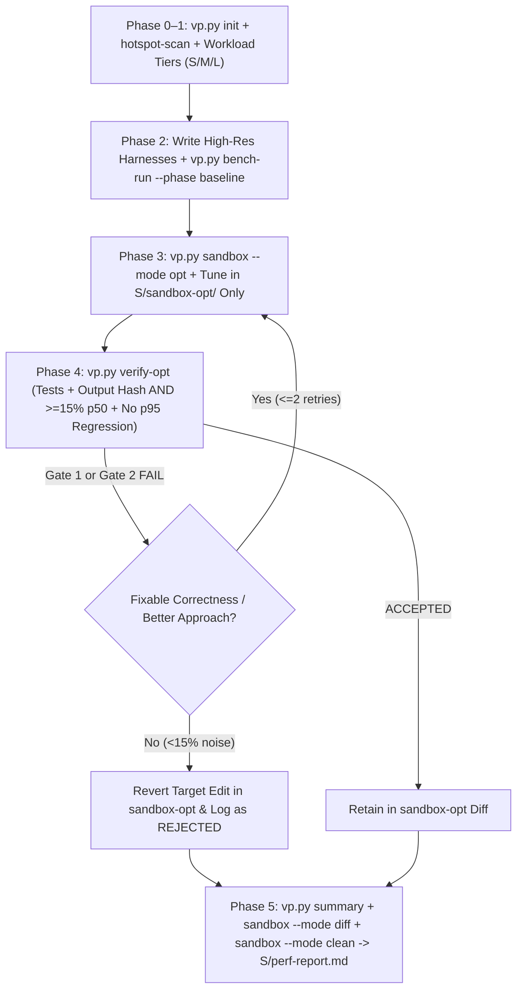

# VeriPerf ⚡📊

[](https://agentskills.io)
[](https://github.com/lufus4826-eng/veriperf/releases/tag/v1.0.0)
[](LICENSE)
[](#installation)
[](#supported-stacks--language-adapters)
[](#prerequisites)
[](https://github.com/lufus4826-eng/verihunt)

> **VeriPerf — Statistical Performance Profiling & Dual-Gate Sandbox Optimization Agent Skill.**  
> Stop letting AI agents optimize code by visual guesswork. VeriPerf scans for algorithmic and I/O bottlenecks, measures **Small / Medium / Large** workloads across `3–5` warm-up and `15–30` timed iterations (`p50`, `p95`, Peak Memory), tunes code inside an isolated sandbox, and **automatically rejects and reverts** any change that breaks tests, alters output hashes, or gains less than **15%**.

---

## Why VeriPerf?

When you ask an AI coding agent to *"optimize this code"*, three things usually go wrong:
1. **Placebo micro-tweaks:** The agent makes code harder to read for a 1–3% speedup that is indistinguishable from CPU jitter.
2. **Silent regressions:** An aggressive refactor subtly changes edge-case rounding, ordering, or test behavior.
3. **Token bloat:** Running 20–30 benchmark iterations raw in the shell floods the agent's context window with thousands of lines of noisy stdout.

**VeriPerf solves all three using a deterministic Python CLI engine (`scripts/vp.py`) and strict Dual Gate verification:**
- **Correctness Gate (Gate 1):** Existing project tests must pass (`exit=0` with zero broken-harness signals) **and** deterministic output checksums (`result_hash`) must match 100% across `small`, `medium`, and `large` tiers.
- **15% Statistical Speedup Gate (Gate 2):** Primary-tier median latency (`p50`) must improve by **at least 15.0%**, and `p95` tail latency must not regress. Sub-15% edits are automatically flagged `REJECTED` and reverted from `sandbox-opt/`.
- **Compact Token Footprint:** Multi-tier `p50`/`p95`/memory results are compressed by `vp.py` into **<=10-line** digests so the agent never reads raw JSON/log files.

---

## Verified Benchmark Case Study

Tested end-to-end (`warmup=5`, `runs=20`, `MIN_SPEEDUP=15.0%`) on a multi-module Python portfolio analytics suite containing `O(N^2)` trade reconciliation, audit-log parsing/concatenation overhead, and an already-linear fee loop:

| Target | Optimization Tested | Primary Tier | Baseline `p50` | Optimized `p50` | `p50` Speedup | `p95` Change | Peak Memory | Hash | Dual Gate Verdict |
|---|---|---|---:|---:|---:|---:|---:|---|---|
| **OPT-1** (`reconcile_trades`) | Replaced `O(N*M)` nested scan with `O(N+M)` hash-map index | `large` | `142.700 ms` | `1.603 ms` | **+98.9% (88.99x)** | +98.8% | -60.3% | MATCH | **ACCEPTED** |
| **OPT-2** *(Attempt 1)* | Hoisted regex + buffered strings in `list.append` | `large` | `24.844 ms` | `21.300 ms` | **+14.3%** | +13.8% | -537.9% (worse) | MATCH | **REJECTED (`<15%`)** |
| **OPT-2** *(Attempt 2)* | Streaming length accounting + `O(1)` ASCII slice validation | `large` | `24.844 ms` | `20.774 ms` | **+16.4% (1.20x)** | +16.9% | **+95.5% saved** (`70.2 -> 3.1 KB`) | MATCH | **ACCEPTED** |
| **OPT-3** (`compute_batch_fees`) | Local variable micro-binding (`rnd = round`) | `large` | `41.046 ms` | `39.714 ms` | **+3.2%** | +5.4% | +9.5% | MATCH | **REJECTED (`<15%`, reverted)** |

> **Key takeaway from OPT-2:** On Python 3.13, a textbook `list.append + "".join` refactor actually *failed* the 15% gate (`+14.3%`) and increased peak memory by 5.4x. Because VeriPerf refused to accept unverified intuition, it forced a true zero-buffer optimization that cut memory by **95.5%** and cleared the **15%** bar.

---

## Quick Start

### Prerequisites
- **Python 3.9+** available on `PATH` as `python` (used by `scripts/vp.py`; **zero external `pip` packages required**).
- Your target project's native runtime/toolchain (Python, Go, Node.js, Java/Kotlin, .NET, or Rust).

### Installation

#### 1. Claude Code
```bash
# User-global installation (Recommended)
git clone https://github.com/lufus4826-eng/veriperf.git ~/.claude/skills/veriperf

# Or project-local installation
git clone https://github.com/lufus4826-eng/veriperf.git .claude/skills/veriperf
```

#### 2. Google Antigravity / Gemini CLI
```bash
# Linux / macOS
git clone https://github.com/lufus4826-eng/veriperf.git ~/.gemini/config/skills/veriperf

# Windows (PowerShell)
git clone https://github.com/lufus4826-eng/veriperf.git "$HOME\.gemini\config\skills\veriperf"
```

#### 3. Cursor / Windsurf / Roo Code / Cline / Other Agent Runtimes
```bash
git clone https://github.com/lufus4826-eng/veriperf.git .agents/skills/veriperf
```

### Example Prompts
```text
/veriperf profile and optimize bottlenecks in this repository with before/after benchmarks
/veriperf hunt O(N^2) loops, N+1 queries, and excessive memory allocations in src/billing
/veriperf benchmark and speed up the order reconciliation pipeline without breaking tests
```

---

## Methodology & 5-Phase Workflow



| Phase | Purpose | Enforcement Mechanism |
|---|---|---|
| **Phase 0–1: Hotspot Discovery** | Locate bottlenecks & define Small / Medium / Large dataset sizes | `vp.py init` + `vp.py hotspot-scan` (`<=35` lines) + `resources/hotspot-patterns.md` |
| **Phase 2: Baseline Capture** | Capture statistically stable pre-tuning metrics without modifying host code | `vp.py bench-run --phase baseline` (`warmup >= 3`, `runs >= 15`, `p50`, `p95`, `peak_kb`, `result_hash`) |
| **Phase 3: Sandbox Tuning** | Implement algorithmic, batching, streaming, or caching fixes safely | Isolated copy at `.bughunt/perf-*/sandbox-opt/` via `vp.py sandbox --mode opt` |
| **Phase 4: Dual Gate Check** | Prove functional equivalence AND statistically meaningful speedup (`>= 15%`) | `vp.py verify-opt` rejects & reverts `<15%` gains, `p95` regressions, hash mismatches, or test failures |
| **Phase 5: Benchmark Report** | Deliver audit-ready Before/After report and clean temporary sandboxes | `vp.py summary` + `sandbox --mode diff` + `sandbox --mode clean` -> `S/perf-report.md` |

---

## `scripts/vp.py` CLI Reference

| Subcommand | Description |
|---|---|
| `init [--root .]` | Creates `.bughunt/perf-<YYYYMMDD-HHMMSS>/{benches,logs,tmp}` + `.cache`, captures `fs-before.txt`, initializes `worklog.md`, and outputs 1-line JSON `{S, SNAME, CACHE, ROOT, snapshot}`. |
| `hotspot-scan [--root .] [--scope dir] [--s S]` | Runs Python AST + multi-language structural scanning for `NESTED_LOOP`, `N_PLUS_ONE_IO`, `UNBOUNDED_MEMORY_READ`, and `LOOP_ALLOC_OR_RECOMPILE` (excluding test files), printing a ranked `<=35`-line report. |
| `bench-run --s S --id ID --phase baseline\|opt [--warmup 5] [--runs 20] [--tier all] -- <cmd>` | Enforces `warmup >= 3` and `runs >= 15`, parses `VERIPERF_METRIC:` JSON lines (or times subprocesses as fallback), computes `p50`, `p95`, `mean`, `CV%`, `peak_kb`, and `result_hash`, and prints a **<=10-line** digest. |
| `verify-opt --s S --id ID [--min-speedup 15.0] [--test-cmd "..."]` | Runs benchmark inside `S/sandbox-opt/`, executes `--test-cmd` (checking exit `0` + broken-harness signals), verifies exact `result_hash` parity across all tiers, and enforces the `>=15.0%` `p50` floor + `p95` non-regression (`<=12`-line digest). |
| `sandbox --s S --mode create\|opt\|diff\|clean [--force]` | Clones project into `S/sandbox-opt/` (preserving `vendor/`, excluding `.git`/caches/build dirs), prints `<=8,000`-char unified diffs (`diff`), or removes sandboxes and verifies `fs-before.txt` vs `fs-after.txt` (`clean`). |
| `log --s S [--status "..."] [--entry "..."]` | Atomically updates `Status:` on line 1 of `S/worklog.md` and appends timestamped 1-line entries without rewriting the file. |
| `summary --s S` | Generates ready-to-embed Markdown comparison tables from session JSON logs (`ACCEPTED` and `REJECTED` targets) without reading raw logs. |

### `VERIPERF_METRIC:` Harness Protocol
Language harnesses write one JSON line per workload tier to stdout:
```text
VERIPERF_METRIC:{"tier":"large","warmup":5,"runs":20,"samples_ns":[1612400,1598200,...],"peak_kb":317.2,"result_hash":"8da897776a12bc90"}
```
`vp.py` sets `VERIPERF_TARGET_ROOT` (`ROOT` during `baseline`, `S/sandbox-opt` during `opt`), `VERIPERF_WARMUP`, `VERIPERF_RUNS`, and `VERIPERF_TIER` automatically so the same benchmark script measures both baseline and sandbox-tuned code identically.

---

## Supported Stacks & Language Adapters

| Language | Monotonic Timer | Memory Metric | Isolation & Build Strategy |
|---|---|---|---|
| **Python** | `time.perf_counter_ns()` | `tracemalloc` peak heap (post-timing pass) | `VERIPERF_TARGET_ROOT` + `PYTHONPATH`, `PYTHONDONTWRITEBYTECODE=1` |
| **Go** | `time.Now()` / `time.Since()` | `runtime.ReadMemStats` `TotalAlloc` delta | `S/sandbox[-opt]/`, `go test -count=1`, `GOCACHE`, `GOPROXY=off` |
| **Node.js / TS** | `process.hrtime.bigint()` | `process.memoryUsage().heapUsed` | `VERIPERF_TARGET_ROOT` + `NODE_PATH`, `npm_config_offline=true` |
| **Java / Kotlin (JVM)** | `System.nanoTime()` | `Runtime` heap / `MemoryMXBean` | `S/sandbox[-opt]/`, `mvn -o` / `gradlew --offline` |
| **C# (.NET)** | `Stopwatch.GetTimestamp()` | `GC.GetAllocatedBytesForCurrentThread()` | `S/sandbox[-opt]/`, `dotnet test -c Release --no-restore` |
| **Rust** | `std::time::Instant` + `black_box` | Tracking allocator / RSS | `S/sandbox[-opt]/`, `cargo test --release --offline --locked` |

---

## Repository Structure & Session Deliverables

### Repository Layout
```text
veriperf/
├── SKILL.md                          # Master 5-phase workflow & token guardrails
├── README.md                         # Documentation & benchmark methodology
├── CONTRIBUTING.md                   # Contributor & adapter authoring guide
├── LICENSE                           # MIT License
├── scripts/
│   └── vp.py                         # Zero-dependency stdlib Python CLI engine
└── resources/
    ├── hotspot-patterns.md           # Bottleneck pattern & remediation catalog
    ├── report-template.md            # English 6-section report template (Phase 5 lazy-load)
    ├── report-template-th.md         # Thai 6-section report template (Phase 5 lazy-load)
    └── lang/                         # Language-specific timing & memory adapters
        ├── 00-common.md              # VERIPERF_METRIC protocol & statistical rules
        ├── python.md
        ├── go.md
        ├── js-ts.md
        ├── jvm.md
        ├── dotnet.md
        └── rust.md
```

### Session Output (`.bughunt/perf-<YYYYMMDD-HHMMSS>/`)
```text
.bughunt/perf-20261116-203001/
├── perf-report.md        # Final 6-section statistical report & verified diffs
├── worklog.md            # Append-only progress journal
├── benches/              # Reproducible multi-tier benchmark harnesses
└── logs/                 # Structured tier JSON metrics, verify verdicts & fs snapshots
```
> **Note:** Add `.bughunt/` to `.gitignore` or `.git/info/exclude` — session logs and benchmark artifacts should not be committed into your target repository.

---

## VeriHunt Ecosystem

VeriPerf pairs directly with **[VeriHunt](https://github.com/lufus4826-eng/verihunt)** using the shared `.bughunt/` workspace convention:
- Use **`/verihunt`** to hunt and prove **correctness, concurrency, and security bugs** (`FAIL` -> `PASS` in `sandbox-fix`).
- Use **`/veriperf`** once code is functionally sound to eliminate **`O(N^2)` loops, N+1 I/O, and memory bloat** (`>= 15%` proven speedup in `sandbox-opt`).

---

## Contributing & License

- Contributions, new language adapters, and AST/scanner improvements are welcome! See [CONTRIBUTING.md](CONTRIBUTING.md).
- Licensed under the **MIT License** — see [LICENSE](LICENSE).
